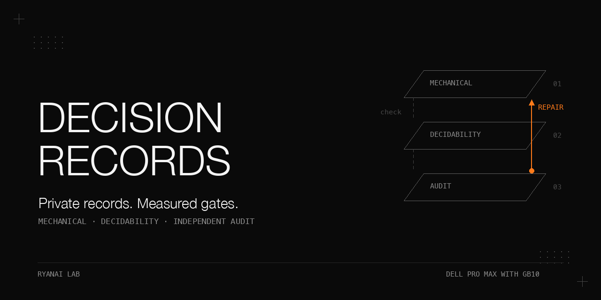

# Turning decision records into training data: three de-identification gates that have to converge

Private decision records can become labelled training triples, but no single check makes them safe to move.
This cookbook follows a mechanical gate, a decidability gate with a measured noise floor, and an independent
re-identification audit, with a separate label-leak filter between repairs and evaluation.
The reviewer counted 52, 28, 27, 28, 1 and 0 findings across six rounds; a seventh, ROUTE-only round found 6.
Those counts mix repairs with a change of counting rule, so we publish both rulers and the failures behind them.
The dataset stays private. Everything under `fixtures/` is clearly synthetic, including `FictionalPerson`.

## Why this matters

Removing names can remove the signal a decision depends on. Keeping signal can preserve an identity shortcut.
A model can also introduce new defects: poisoned placeholder mappings, invented codes, erased severity tags,
meaningful placeholder names, and answers embedded in the question.
A mechanical pass cannot detect every unknown name; agreement with a reader cannot prove training quality;
a clean audit sample cannot establish a clean corpus.

The original work delivered 711 rows: 679 REVIEW and 32 ARCH. It held back 194 ROUTE rows.
No model was trained on the delivered data. The lesson is the gating method and its limits, not a training result.
Review samples were sent to a hosted model. The egress pre-check scanned prompts but not samples,
and early samples still contained private identifiers. **Scan what leaves, not only the prompt.**

## What is in this book

1. [From records to triples](docs/extraction.md): construct states without copying recorded outcomes into them.
2. [The mechanical gate](docs/mechanical-gate.md): scan every decision field, case-insensitively and fail-closed.
3. [Letting a model rename things](docs/placeholder-map.md): diagnose shared-map poisoning and deterministic repairs.
4. [Decidability and noise](docs/decidability.md): separate reader instability from raw-versus-scrubbed disagreement.
5. [Label leaks](docs/label-leaks.md): reject states that reveal a choice directly or by elimination.
6. [Independent audit](docs/audit.md): use a written acceptance rule and report two counting rulers honestly.
7. [The held-back class](docs/routing-ablation.md): test identity dependence without claiming a proven cause.
8. [Operating the pipeline](docs/operations.md): reproduce the mechanics offline and rerun downstream gates.

[All results and conditions](docs/results.md) and [expanded pitfalls](docs/pitfalls.md) retain the detailed evidence.
Historical results are transcribed from the supplied experiment record; private row-level evidence is not shipped.

## The setting

Conditions: original runs on 2026-09-22; the supplied record dates retrospective calculations and original mock checks to 2026-10-04.

| Item | Recorded setting |
|---|---|
| Hardware | Two Dell Pro Max with GB10 machines, tensor parallel |
| Local model | Qwen3.8-Flash-Next (NVFP4), same model for scrubbing, reading, leak checking and descriptions |
| Serving | vLLM, fp8 KV cache, MTP4 speculative decoding, async scheduling off; shared with live workloads |
| Build | Related recipe says `v0.1.dev20759+gb40673cd0`; exact build for these runs was not recorded |
| Calls | Temperature 0, thinking disabled; scrub max_tokens 900; readout max_tokens 2, top_logprobs 20 |
| Reliability settings | Timeout 180 s; 2 attempts with 2 s back-off |
| Tools | Python 3 standard library only (checked on a recent Python 3; minimum version not established); the banner script separately uses Pillow |
| Independent audit | Hosted frontier model, read-only sandbox, maximum reasoning effort; 50-row samples |

Labels came from recorded outcomes: the actual lane, the written APPLY/REJECT verdict, or the chosen option.
No commercial decision model's output is included. The production endpoint's exact build remains unknown.
A real rerun needs a chat-completions server with first-token logprobs, private records, a private map location,
and an independent reviewer. This repository's synthetic demo needs none of that infrastructure.

## Chapter 1: From records to triples without built-in leaks

**Problem.** A convenient extraction can put the answer in its own state before any privacy operation begins.
The common schema is `id, source, gate, state, question, options, label, extra, provenance`.
Here `gate` means the row class: ROUTE, REVIEW or ARCH.

**Mechanism.** ROUTE keeps Task, Shape and Goal, normalizes the actual lane through configurable substring rules,
and keeps declared lane/result/rework out of the state. A bare task identifier is enriched from the task table's
`what` cell only. REVIEW reads the finding and verdict, never the `change` column.
ARCH asks for a generated pre-decision context and named options from the first 6,000 characters of a record.
It requires at least 2 options and a verbatim label; a text-hash-seeded shuffle removes chosen-first ordering.
Reject a context with a 25-character common substring or at least 60 % overlap with label tokens of length 3 or more.
Retry once without the decision, then drop. Malformed JSON also gets one parse-repair retry.

**Procedure as run.** Sources were read read-only. The first ARCH prompt lacked the guard; after audit round 1,
the prompt and overlap filter were added and the 157 records were re-extracted. Task descriptions were back-filled.

Conditions: 2026-09-22; different extraction versions, not repeated measurements of one fixed prompt.

| Measurement | Result |
|---|---|
| ROUTE | 204 extracted; 13 still bare identifiers after back-fill |
| REVIEW | 679 extracted from 689 specified table rows; 499 with file context |
| ARCH, unguarded | 157 read, 157 kept |
| ARCH, guarded | 157 read, 131 kept, 26 dropped after retry; 0 option leaks logged |
| ARCH audit round 1 | 10 of 17 leaked: 8 outright and 2 paraphrases, in a 50-row sample |
| ARCH audit round 2 | 1 explicit plus 1 uncertain in 17 |

**What did not work.** Asking for “the situation” was insufficient. The overlap thresholds were never calibrated.
The historical extractor still saw the full decision record; a choice-blind instruction did not make its input label-blind.
**Rule.** Construct states without access to the label where possible, and record where that separation was not achieved.

## Chapter 2: The mechanical gate

**Problem.** Recognizable private strings must not depend on a model's judgment to be rejected.
**Mechanism.** Load one regex per non-comment line, then scan `state + options + label` case-insensitively.
Flag matches as `scrub_failed`; downstream sampling excludes failures. A token table maps known survivors to class placeholders.
Strip day residue next to month placeholders and line references that add linkability without decision signal.
Credential patterns split their literal prefixes with character classes, such as `[s]k-`, so the pattern file is not itself a credential-shaped artifact.

**Procedure as run.** The first gate was case-sensitive and narrower. After round 1 it scanned all decision fields,
added a token post-pass, and grew with later findings. The final v7 rescan added 5 words.

Conditions: 2026-09-22; full stage-by-stage populations are in [results](docs/results.md#mechanical-gate).

| Stage | Rows | Pass / fail |
|---|---|---|
| First ROUTE + REVIEW scrub | 883 | 880 / 3 |
| First ARCH scrub | 157 | 152 / 5: 1 IP, 2 paths, 2 names |
| Guarded ARCH scrub | 131 | 128 / 3 |
| Case-insensitive ARCH post-pass | 128 | 124 / 4 |
| Usable after all steps, v5 to v7 | 922 | 905 / 17, including earlier failures |
| v7 rescan | 905 | REVIEW 679 and ARCH 32: zero hits; 4 ROUTE rows hit |

**What did not work.** Four regex lines and a token table growing from 9 to 29 entries could not enumerate the shorthand long tail.
Lowercase-only slug patterns missed month placeholders; non-space patterns missed rewritten Goal values with spaces.
**Rule.** Fail closed over every field that leaves. The list remains incomplete even when its current scan is clean.

## Chapter 3: Letting a model rename things

**Problem.** Stable placeholders should preserve relationships, but a shared map can spread a bad replacement across the corpus.
**Mechanism.** Apply existing map entries longest-first, ask for text plus entity mappings, assign class numbering,
and rewrite model numbering to the shared map. Free-text options are scrubbed separately; the label follows its option index.
The historical substitution uses plain `str.replace`, without word boundaries; this remains a documented adapter limitation.

`mapclean.py` rejects malformed placeholders, short originals, public keep-list entries, class words and placeholder-shaped originals.
It reverses a discarded mapping only if its placeholder is not retained by another entry, then turns literal `class_N` into `class_0`.
`postscrub2.py` gives distinct codes distinct `ref_N` values, normalizes malformed forms, and aligns unknown projects with raw tokens.
Configured severity tags and the generic word “project” are restored; true slugs get placeholders. Duplicate options fail.

**Procedure as run.** Repairs restarted from the last model-scrubbed file, not the previously repaired file.
The first code repair collapsed distinct codes to one literal, then v5 restored distinctions; v6 used neutral `ref_N` names.

Conditions: map snapshot at repair on 2026-09-22; mechanism inferred from code and counts, not isolated experimentally.

| Measurement | Result |
|---|---|
| Map entries | 523 -> 243; 280 dropped |
| Drop reasons | Malformed 88; short 40; public names 10; class/placeholder originals 142 |
| Existing placeholder originals renumbered | 116, all to different placeholders |
| Repair effect | 192 replacements reversed; 611 of 1,014 rows changed |
| Distinct codes | 91 at v5; 93 at v6 and v7 |
| Severity recovery | 126 tags restored; source comment says 127; 12 rows remain project_0 |

**What did not work.** Unvalidated model entities poisoned the map; single-literal code replacement destroyed distinctions;
`code_N` carried semantic bias. The recorded kept-map class breakdown does not reconcile with the 243 total; it is preserved with that caveat.
**Rule.** Validate map entries, avoid substring collisions, and inspect many-to-one repairs. A shared map is private data.

## Chapter 4: The decidability gate with a measured noise floor

**Problem.** A reader can disagree with itself even at temperature 0, so a raw/scrub comparison mixes noise and damage.
**Mechanism.** Present state, question and lettered options, plus “None of these; escalate”. Read first-token top-20 logprobs.
Map a token's first character to an option letter; missing letters receive the minimum observed logprob minus 3, then softmax.
Read each side 3 times; compare majority letters. The original floor compared raw read 1 with raw read 2.
PASS means agreement >= floor - 0.05. The gate ignores recorded labels.

**Procedure as run.** A single-read 0.95 rule gave 10 of 18 agreements (0.556) on early ROUTE rows and was replaced.
Early runs sampled 40 per class. At v6 the gate read all 194 ROUTE, 200 REVIEW and all 32 ARCH rows.
The raw REVIEW side was context-stripped for the final comparison. ROUTE and REVIEW were not gated at v2, v3 or v4.

Conditions: original 2026-09-22 runs; majority of 3 reads, single-pair floor; all runs appear in [results](docs/results.md#original-decidability-runs).

| Version | Class / n | Agreement | Floor | Result |
|---|---|---|---|---|
| v1, seed 11, project slug still clear | ROUTE / 40 | 0.850 | 0.725 | PASS |
| v5, code_N, seed 13 | ROUTE / 40 | 0.600 | 0.750 | FAIL |
| v5, raw context still affects comparison | REVIEW / 40 | 0.900 | 1.000 | FAIL |
| v6, ref_N, seed 17 | ROUTE / 194 | 0.680 | 0.784 | FAIL; threshold 0.734 |
| v6, raw context stripped | REVIEW / 200 | 0.950 | 0.970 | PASS; threshold 0.920 |
| v6 | ARCH / 32 | 1.000 | 1.000 | PASS |
| v7, descriptions, seed 19 | ROUTE / 194 | 0.680 | 0.763 | FAIL; threshold 0.713 |

**What did not work.** The v1 pass was mainly a data-version effect, with sampling noise on top: the identity was still present.
In v6, only 127 of 194 ROUTE rows had unanimous raw reads (65.5 %). Reader jitter's cause was not isolated.
Retrospective REVIEW chance agreement was 0.887 against a 0.920 threshold, so that gate had little power.
The original gate read raw options on both sides, missing changed options in 7 of 32 delivered ARCH rows.

**Implemented after the original runs:** `--scrubbed-options` reads delivered options; `--stability-report` splits unanimous and split raw reads;
`--floor-estimator mean-pairs` uses the mean of the three raw-read pairs. These are new, mock-tested code.
Attribution also recognizes `ref_N` and `id_N`. Historical convergence numbers come from the original gate, not these improvements.
**Rule.** Measure self-disagreement, report marginals and chance agreement, and distinguish consistency from label accuracy.

## Chapter 5: Label leaks: the answer hiding in the question

**Problem.** A private-free state can still teach a student to copy its answer.
**Mechanism.** There were five routes: ARCH restating a decision, ARCH rejecting the alternative, ROUTE naming its lane,
REVIEW exposing a file revised after the verdict, and the REVIEW change column explicitly describing the action.
The controls were guarded extraction, a semantic leak filter, `label_in_state` rejection, context removal and column exclusion.

The semantic check asks whether CONTEXT reveals, states or strongly implies which option was chosen or rejected.
Read Yes/No first-token logprobs, softmax with missing tokens at minimum minus 3, repeat 3 times and take the median.
Drop at p(yes) >= 0.5. Fixed-vocabulary rows pass through; the adapter rejects missing/incomplete model reads.
**Procedure as run.** Apply this filter to the 124 usable ARCH rows after extraction, map cleanup and mechanical checks.

Conditions: 2026-09-22; uncalibrated threshold and no labelled leak set.

| Measurement | Result |
|---|---|
| ARCH entering / dropped / kept | 124 / 92 (74 %) / 32 |
| Dropped p(yes) bands | 0.5-0.6: 11; 0.6-0.8: 38; 0.8-1.0: 43 |
| Kept p(yes) bands | Below 0.2: 11; 0.2-0.4: 14; 0.4-0.469: 7 |
| Dropped rows straddling threshold | 9 of 92 |
| End-to-end ARCH yield | 32 of 157 (20 %) |
| REVIEW contexts removed | 499 of 679 rows |

**What did not work.** Prompting alone lost 26 records and still left 92 later judged leaky. Model p(yes) is not calibrated probability.
The supplied distributions retain their reported band boundaries; no exact boundary assignments are reconstructed here.
**Rule.** Test answer exposure separately from privacy, and publish the yield at each stage rather than just the survivors.

## Chapter 6: The independent audit and the convergence record

**Problem.** Unknown identifiers and linkage clues need adversarial review beyond a regex list.
**Mechanism.** Give an independent reviewer only a projected sample: id, class, state, question, options and label.
The final prompt counts real identities, private endpoints/credentials, internal names/slugs, day-level dates,
malformed or same-record ambiguous placeholders, and label leaks. Public technical names and repository-relative paths are allowed.
Keep optional notes separate; require a final `AUDIT: CLEAN` or `AUDIT: LEAKS (n)` line.

**Procedure as run.** The acceptance rule was written after round 3, before round 4, but reached the prompt only at round 5.
Every round changed both the sample and data version. Later mixed samples balanced REVIEW verdicts.

Conditions: 2026-09-22; 50 rows each; final-rule re-tally is one reader's retrospective judgment, not an independent audit.

| Round / data | Reviewer | Final-rule re-tally | Sample condition |
|---|---|---|---|
| 1 / v1 | 52 | 34 hard, 18 allowed | Up to 17 per class |
| 2 / v2 | 28 | 17 hard, 2 uncertain, 9 allowed | Up to 17 per class |
| 3 / v3 | 27 | 7 hard, 2 uncertain, 18 allowed | REVIEW 16 of 16 APPLY |
| 4 / v4 | 28 | 4 hard + 5 self-inflicted + 19 allowed | 17 ROUTE, 8 APPLY + 8 REJECT, 17 ARCH |
| 5 / v5 | 1 | 1 hard | Balanced as round 4; rule now in prompt |
| 6 / v6 | 0 | 0 hard | Balanced, new seed; 17 ROUTE |
| 7 / v7 | 6 | 6 hard in 3 rows | 50 ROUTE only |

**What did not work.** “52 to 0” is not a fixed-ruler trend. The old round-4 note “24 of 28 allowed” is superseded by this re-tally.
Zero findings in 50 random rows implies an approximate 5.8 % row-level upper bound at 95 % confidence,
not zero risk; the actual stratified sample is not a class-specific certificate. No sample was re-audited.
Hosted review consumed 350 row-views. Private strings left in early samples because the pre-check covered only prompts.
**Rule.** Put the rule in the prompt before the first round, audit classes separately, and scan both prompt and sample before egress.

## Chapter 7: The class we held back

**Problem.** ROUTE failed twice and kept exposing new shorthand. Holding it back was preferable to relaxing acceptance.
**Mechanism.** A description writer saw each slug and up to 6 task lines, requested 3 to 10 generic words,
and rejected outputs over 12 words or containing years, lane terms, patterns or known private tokens.
It accepted 40 of 41 descriptions, applied to 183 of 194 rows. Agreement stayed 0.680.

**Procedure as run.** After v7's gate and ROUTE-only audit, isolate transformations on 185 matched rows with Goal lines.
Each variant ran once, 3 reads per side, seed 23, on 2026-09-22 from 20:06 to 20:18.

| Variant | Change | Agreement / floor | Result |
|---|---|---|---|
| V1 | Raw with v7 Goal | 0.714 / 0.778 | FAIL; threshold 0.728 |
| V2 | Raw with codes changed to ref_N | 0.773 / 0.773 | PASS, no loss |
| V3 | v7 with raw Goal restored | 0.784 / 0.768 | PASS, no loss |

Derived on 2026-10-04: paired exact two-sided p-values were 0.085, 0.144 and 0.878 for V3/V1, V2/V1 and V3/V2.
None reached 0.05 significance; V1 missed its pass threshold by 1.4 points. Project identity as a shortcut is suggestive, not proven.
The stronger observations are two full-set failures and the stability-stratified agreement split.

**What did not work.** Generic descriptions provided no agreement gain; enumerating shorthand did not converge.
The 194 held-back rows were 21.4 % of the 905 usable rows; their majority label share was 56.7 %.
**Rule.** Test one transformation at a time and hold back a class when the current privacy and consistency gates do not converge.
**Proposal, not done:** re-extract ROUTE from shape, risk, estimate and production-touch attributes, then rerun all gates.
The estimate of half a day of local compute and two audit rounds was not measured. This repository does not implement that redesign.

## Chapter 8: Operating the pipeline

**Problem.** Repairs invalidate later evidence. The original process skipped that discipline at v2 through v4.
**Mechanism.** Extract -> model scrub -> map clean -> deterministic repairs and mechanical rescan -> semantic leak filter
-> decidability -> independent audit. Restart repairs from the last model-scrubbed file and rerun every downstream gate.
The parameterized runner stops on a failed command, builds a verdict-stratified sample and scans both outbound inputs.
A no-op reviewer cannot yield CLEAN; the default offline path reports `AUDIT NOT RUN`.

**Procedure as run.** Original round-specific wrappers repaired, sampled, gated and audited successive versions.
The public runner consolidates them and enables the new gate options. It is not the original production run.

Conditions: 2026-09-22 local wall clock; rounded time labels and reported durations are preserved in [the complete timeline](docs/results.md#timeline-and-cost).

| Work | Recorded cost |
|---|---|
| First scrub to final ablation | 17:47 to 20:18; 2 h 31 min |
| Scrub 883 ROUTE + REVIEW rows | 37.5 min |
| Scrub 157 ARCH records, options and labels | 12.6 min |
| ROUTE repeated reads | About 0.21 s each; 1,164 reads in about 4 min 8 s |
| Hosted reviewer | 7 calls; 1.7 to 4.3 minutes where logged; no monetary total supplied |

**What did not work.** A foreground extraction exceeded a 580 s tool limit; a separate failed execution attempt consumed 23 minutes.
For long extraction, use a detached job with a local log. The local model had no per-token charge; external review still had cost and egress.
**Rule.** Start with synthetic fixtures and the mock, then introduce private data locally; rerun all later gates after any change.

## Pitfalls

| Symptom | Root cause | Fix |
|---|---|---|
| Every call returns 404 | Base omitted /v1 | Keep /v1 in the base; scripts append /chat/completions |
| Names survive in options or capitalized text | State-only or case-sensitive scan | Scan all decision fields case-insensitively |
| Distinct alternatives become identical | One literal used for different codes | Distinct ref_N mappings and duplicate-option rejection |
| Severity becomes an unknown project | Scrubber misclassifies a decision signal | Align with raw text and restore configured tags |
| REVIEW fails after context removal | Raw side still includes revised-file context | Remove the same field on both sides |
| A clean audit is followed by class-specific leaks | Different samples and uneven coverage | Audit each class and report sample composition |
| Prompt passes but private sample leaves | Egress check covers the wrong artifact | Scan both prompt and sample |

[Expanded pitfalls](docs/pitfalls.md) explain the remaining failure modes and evidence limits.

## Reproduce it without our infrastructure

Run these steps from the repository root. No external service, weights, private records or third-party Python package is needed.

1. Run the offline tests. They construct temporary files inside the repository and clean them up.

```sh
PYTHONDONTWRITEBYTECODE=1 python3 -m unittest discover -s tests -v
```

2. Run the complete synthetic pipeline in a new work directory. The default mock transport uses no sockets.

```sh
PYTHONDONTWRITEBYTECODE=1 python3 scripts/demo.py --work-dir .work/demo
```

3. Read `.work/demo/pipeline.log`, `gate-summary.json` and `audit.txt` locally. The work directory is ignored using its own `.gitignore`.
It contains raw synthetic triples, maps, repaired rows, reads and a sample. A real-data work directory would be private.
The recorded clean fixture expectation is 36 ROUTE + 40 REVIEW + 8 ARCH = 84 rows, 6 enrichments, 6 map entities,
76 repaired rows, 12 codes and no leak-filter drops. These are fixture counts, not the private dataset.
The demo ends with `PIPELINE COMPLETE; AUDIT NOT RUN`, not a re-identification clearance.

4. Exercise the repeated-read gate's synthetic noise or bias modes using the commands in [the runbook](docs/operations.md).
The tests include an option-only planted bias: the historical option path passes while the delivered-options path catches it.

5. Optionally run `python3 scripts/demo.py --http --work-dir .work/http-demo` where loopback binding is permitted.
It binds a free loopback port directly. The listener path was blocked by the authoring environment and was not validated there.
The in-process transport exercises the same mock response code, but does not validate HTTP socket handling.

6. Inspect the prompts and `review_runner.sh` contract before supplying an independent reviewer command.
The wrapper scans both inputs and projects a minimal sample; read-only sandbox enforcement belongs to the supplied command.
No hosted reviewer was invoked for this repository's tests. The mock does not implement description generation; only its validator is tested.

## Limits and open questions

- No training run: the gates measure consistency and sampled leaks, not downstream quality.
- Same local model for scrubbing and reading; correlated blind spots and endpoint jitter remain unresolved.
- Slack 0.05, overlap 25 characters / 60 %, and leak threshold 0.5 were not calibrated; leak recall is unknown.
- REVIEW is 91.6 % APPLY, mean state length 89 characters; ARCH has only 32 delivered rows. Weighting or subsampling remains necessary before training.
- Original REVIEW chance agreement was 0.887; original ARCH comparison never read changed delivered options.
- One reviewer family, changing samples/ruler, no repeated sample; no external linkage attack test.
- Allowed public paths, exact figures and commit fingerprints can combine into identifying context.
- Plain substring map substitution remains risky for longer originals; map poisoning's mechanism was inferred, not isolated.
- Records were mixed-language; routing retained some non-English fragments. Private regex lists must be language-aware.
- Counts depend on one dated review process. The map breakdown discrepancy and exact engine build remain unresolved.
- Routing redesign is only a proposal. New gate improvements have synthetic validation, not a rerun on the private data.

## Files

| Path | Purpose |
|---|---|
| `scripts/extract.py`, `scrub.py`, `mapclean.py` | Adapted extraction, model rewriting and map repair |
| `scripts/postscrub.py`, `postscrub2.py`, `leakcheck.py` | Deterministic repairs, mechanical rescan, semantic leak filter |
| `scripts/decidability.py`, `decid3.py` | Readout helpers and repeated-read gate with optional improvements |
| `scripts/goaldesc.py`, `ablate.py` | Description validator/client and field-isolation variants |
| `scripts/run_gates.sh`, `run_pipeline.py`, `sample.py` | Parameterized runner and minimal stratified sample |
| `scripts/review_runner.sh`, `review_runner.py` | Prompt-and-sample pre-check and optional reviewer adapter |
| `scripts/common.py`, `mock_server.py`, `demo.py` | Configuration, synthetic transport, HTTP mock and offline demo |
| `configs/` | Generic lanes, synthetic repair rules, pattern/token/keep examples and before/after audit prompts |
| `fixtures/`, `tests/` | Synthetic records and offline unittest regressions |
| `docs/` | Chapter detail, all result tables, pitfalls, implementation notes and banner script |

LICENSE and the root .gitignore are copied unchanged from the supplied templates.

## Related cookbooks

- [ryanai-evalbank](https://github.com/ryangu00/ryanai-evalbank): private questions; sensitive-page exclusion and private-IP masking are a narrower privacy layer.
- [training-sft-ablation-discipline](https://github.com/ryangu00/training-sft-ablation-discipline): the ablation habit; its privacy rescan covers 20 commits only.
- [training-weights-vs-context](https://github.com/ryangu00/training-weights-vs-context): why train on records and how to retain regression guardrails.
- [dell-pro-max-gb10-qwen3.8-flash-next](https://github.com/ryangu00/dell-pro-max-gb10-qwen3.8-flash-next): local serving recipe.
- [dell-pro-max-gb10-qwen3.8-flash-next-1m-context](https://github.com/ryangu00/dell-pro-max-gb10-qwen3.8-flash-next-1m-context): related serving configuration.
- [dell-pro-max-gb10-vllm-mtp-async-runaway](https://github.com/ryangu00/dell-pro-max-gb10-vllm-mtp-async-runaway): async scheduling off with speculative decoding.
- [ryanai-lab-cookbooks](https://github.com/ryangu00/ryanai-lab-cookbooks): index.

These are GitHub owner-relative repository links; no additional related repositories are inferred.

## License

Apache-2.0. See [LICENSE](LICENSE).
